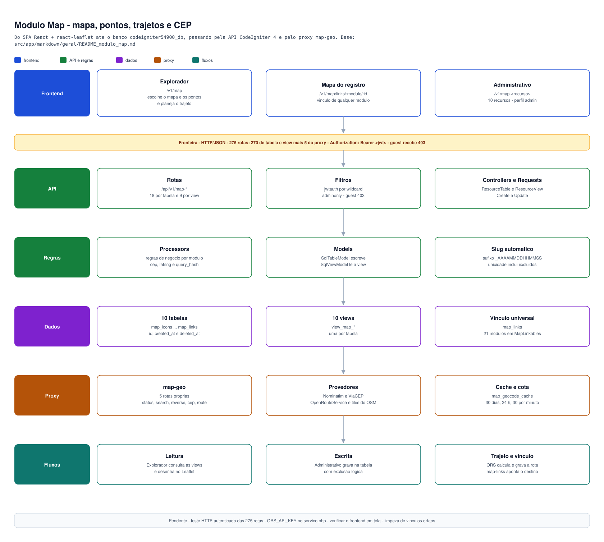

[← Base de conhecimento](../README.md)

# Módulo Map — mapas, pontos, trajetos e CEP

Estado (2026-10-12): **banco DEV aplicado, backend PHP completo e frontend pronto** (ver [`README_mapa.md`](../../../frontend/projeto54900/src/markdown/geral/README_mapa.md)) — 10 tabelas, 10 views e
**270 rotas** de tabela/view (18 por tabela, 9 por view), incluindo o vínculo universal `map_links`
(seção abaixo), mais **5 rotas do proxy** `map-geo` (275 no total). Tabelas e views criadas
direto no banco; `route_manager` sincronizado (243 linhas das 9 primeiras tabelas, idempotente, mais as do
`map_links` e do proxy). **Sem migration** (decisão do usuário: o schema vai
direto no DEV por SQL). O frontend (componentes react-leaflet, Explorador, administrativo dos 10 recursos) está documentado no `README_mapa.md` do frontend; ainda não verificado em tela.
Mapa de rotas em [`README_rotas_swagger.md`](README_rotas_swagger.md) (seção Map).

## Diagrama do módulo

_Visão em quadros do módulo Map — frontend, API, regras, dados, proxy dos provedores e os fluxos principais. O preview reduz a imagem para a largura da janela — [abrir o SVG em tamanho real](diagramas/README_diagrama_map_modulo.svg)._

## Backend (domínio `Map`)

Padrão de [`ROADMAP_padrao_modulo.md`](ROADMAP_padrao_modulo.md), espelho do Timeline: por módulo
`Models/V1/Map/<Modulo>/{SqlTableModel,SqlViewModel}`, `Requests/V1/Map/<Modulo>/{Create,Update}Request`,
`Services/V1/Map/<Modulo>/Processor`, `Controllers/Api/V1/Map/<Modulo>/Resource{Table,View}Controller` e
`Config/Routes/Api/v1/Map/<Modulo>/{EndpointTable,EndPointView}.php`. Módulos: `MapIcons`, `MapManager`,
`MapCategories`, `MapPostalCodes`, `MapAddresses`, `MapPoints`, `MapRoutes`, `MapRouteStops`, `MapGeocodeCache`
e `MapLinks` (vínculo universal) mais o proxy `MapGeo` (slugs `map-icons`, `map-manager`, ... e `<slug>-view`).

- **Autenticação:** `jwtauth` por wildcard (18 entradas em `Config/Filters.php`); `adminonly` em
  `delete-hard` e `clear-deleted` das tabelas. Guest não escreve (403).
- **Regras nos Processors:** `slug` único em `map_manager`; `slug` único por mapa em `map_categories`;
  `cep` com 8 dígitos e único em `map_postal_codes` (máscara removida pela base); `lat`/`lng` sempre juntas
  (422) e nas faixas -90..90 / -180..180 (Request); categoria do ponto precisa ser do mesmo mapa (409);
  `query_hash` (SHA-256 de `provider|texto em minúsculas`) gerado e único em `map_geocode_cache` (409);
  colunas JSON aceitam array no corpo e gravam como string; `user_manager_id` vem da sessão quando ausente.
- **Slug sempre com sufixo no cadastro (2026-10-11):** em `map_manager` e `map_categories` o slug é opcional; vazio =
  gerado do título/nome (ASCII, minúsculas); digitado = texto mantido. Nos dois casos termina em `_AAAAMMDDHHMMSS`
  (ex.: `engenho-novo_20261011173131`); se já terminar assim, não duplica; colisão acrescenta `-NNN`. O update nunca
  troca o slug sozinho (slug editado vale como digitado; repetido = 409). Trait `Services/V1/Map/Concerns/GeneratesSlug`.
- **Unicidade inclui excluídos:** a conferência vê registros com soft delete, porque a UNIQUE do banco também
  os enxerga (evita 500 por violação de chave).
- **Validação feita:** `php -l` em todos os arquivos, `spark routes` = 243 rotas na primeira rodada, antes do `map_links` (27 com `adminonly`; hoje são 270 + 5 do proxy), rotas
  respondem 401 sem token, models/views conferidos contra as colunas reais (0 divergências) e teste em processo
  dos 9 Processors e Requests: 66 verificações, 0 falhas (create/get/update/delete-soft/restore/hard, 409/422,
  JSON, hash, CEP); linhas de teste removidas.
- **Não validado:** chamadas HTTP autenticadas ponta a ponta (exigem login de usuário) e o filtro
  `adminonly` por HTTP.

## Decisão de stack

Leaflet (`react-leaflet`) + OpenStreetMap (tiles) + OpenRouteService (trajetos e
tempo de deslocamento) + Nominatim (busca de endereço e geocodificação) + ViaCEP (CEP).
Nenhum deles tem banco: todo dado persistido fica no MySQL do projeto.

- Banco `default` (`codeigniter54900_db`), prefixo `map_`, como `calendar` e `timeline`.
  Evita colisão com a rota `svg-map` e com o grupo de conexão `mapa`.
- Coordenadas: `lat`/`lng` em `DECIMAL(10,7)` (~1 cm), padrão de mercado; sem tipo espacial.
- Geometria do trajeto: GeoJSON LineString em `LONGTEXT` (formato nativo do Leaflet e do ORS).
- Colunas padrão em toda tabela: `id`, `created_at`, `updated_at`, `deleted_at` (soft delete).

## Tabelas (10) e views (10, `view_map_*`)

| #   | Tabela              | Função                                         | Colunas principais                                                                                                                                                                             |
| --- | ------------------- | ---------------------------------------------- | ---------------------------------------------------------------------------------------------------------------------------------------------------------------------------------------------- |
| 1   | `map_icons`         | Ícones de marcação (facultativo)               | `name`, `icon_type`, `icon_class`, `upload_id`, `color`, `size_w/h`, `anchor_x/y`, `status`                                                                                                    |
| 2   | `map_manager`       | O mapa                                         | `slug` (único), `title`, `center_lat/lng`, `zoom`, `min_zoom`, `max_zoom`, `tile_url`, `attribution`, `roles` (JSON), `status`, `version`                                                      |
| 3   | `map_categories`    | Categoria de ponto                             | `map_manager_id`, `map_icon_id`, `name`, `slug`, `color`, `sort_order`, `status`                                                                                                               |
| 4   | `map_postal_codes`  | Base de CEP                                    | `cep` (único), `street`, `neighborhood`, `city`, `state`, `ibge_code`, `lat/lng`, `source`                                                                                                     |
| 5   | `map_addresses`     | Endereço georreferenciado                      | `map_postal_code_id`, `cep`, `street`, `number`, `complement`, `neighborhood`, `city`, `state`, `country`, `lat/lng`, `geocode_source`, `geocode_precision`, `osm_type/osm_id`, `display_name` |
| 6   | `map_points`        | Pontos no mapa                                 | `map_manager_id`, `map_category_id`, `map_icon_id`, `map_address_id`, `user_manager_id`, `name`, `description`, `lat/lng`, `extra_json`, `status`                                              |
| 7   | `map_routes`        | Trajetos                                       | `map_manager_id`, `user_manager_id`, `name`, `profile`, `distance_m`, `duration_s`, `geometry`, `bbox`, `provider`, `options_json`, `calculated_at`, `status`                                  |
| 8   | `map_route_stops`   | Paradas do trajeto                             | `map_route_id`, `map_point_id`, `map_address_id`, `label`, `lat/lng`, `sort_order`, `leg_distance_m`, `leg_duration_s`, `service_time_s`, `eta`                                                |
| 9   | `map_geocode_cache` | Cache de geocodificação                        | `query_hash` (único), `query_text`, `provider`, `lat/lng`, `result_json`, `expires_at`                                                                                                         |
| 10  | `map_links`         | Vínculo universal módulo ↔ mapa (seção abaixo) | `module`, `reference_id`, `collection`, `link_type`, `map_postal_code_id`, `map_address_id`, `map_point_id`, `map_route_id`                                                                    |

Ordem de criação respeita as FKs (1 a 10, depois as views). Nomes de ruas não têm
tabela própria: a busca vem do Nominatim/ViaCEP e o resultado fica em
`map_addresses` e no cache. Tempo de deslocamento = `duration_s` do trajeto e
`leg_duration_s` por parada.

## Vínculo universal — qualquer módulo recebe CEP, endereço, ponto ou rota

Tabela polimórfica `map_links` (+ `view_map_links`, módulo `MapLinks`, slugs `map-links` e `map-links-view`),
no estilo do Upload: o módulo dono não muda e não tem FK.

| Coluna                                                                 | Papel                                                                                 |
| ---------------------------------------------------------------------- | ------------------------------------------------------------------------------------- |
| `module`                                                               | slug do módulo, ex.: `calendar-events`, `messages-manager`, `upload-manager`          |
| `reference_id`                                                         | id do registro do módulo                                                              |
| `collection`                                                           | papel do vínculo (`location`, `origin`, `destination`, `travel`...; padrão `default`) |
| `link_type`                                                            | `postal_code`, `address`, `point` ou `route`                                          |
| `map_postal_code_id`, `map_address_id`, `map_point_id`, `map_route_id` | destino; só o do `link_type` fica preenchido (FK com cascata)                         |
| `label`, `sort_order`, `status`, `user_manager_id`                     | rótulo, ordem, estado e criador                                                       |

A view devolve o vínculo com o destino resolvido: `target_lat`/`target_lng` (ponto, senão endereço, senão CEP;
nulo para rota), dados do CEP/endereço/ponto e, para rota, `rt_distance_m`, `rt_duration_s` e `rt_geometry`.

### Como um módulo usa o Map (receita)

1. **Registrar o módulo** em [`Config/MapLinkables.php`](../../Config/MapLinkables.php): uma linha
   `'slug-do-modulo' => 'tabela_do_modulo'`. Módulo fora da lista é rejeitado (422). Hoje são 21 módulos: usuários
   (`user-manager`, `user-profiles`), empresas (`company-manager`, `company-members`), `upload-manager`, 6 da agenda
   (`calendar-*`), 4 da timeline, 3 das salas de chat e 5 das mensagens/grupos. A lista de verdade é o próprio arquivo.
2. **Criar o destino** (se ainda não existe): `POST map-points/create`, `map-addresses/create`,
   `map-postal-codes/create` ou `map-routes/create` (+ `map-route-stops`).
3. **Vincular ao registro**: `POST map-links/create` com `module`, `reference_id`, `link_type` e o id do destino.
   Ex.: `{"module":"calendar-events","reference_id":12,"collection":"travel","link_type":"route","map_route_id":3}`.
4. **Ler**: `POST map-links-view/find` com `{"ml_module":"calendar-events","ml_reference_id":12}` traz tudo do
   registro de uma vez.

Regras do Processor: guest não escreve (403); módulo não registrado = 422; `reference_id` inexistente = 404;
exatamente um destino coerente com `link_type` = 422; vínculo repetido (mesmo registro, `collection` e destino)
= 409; `module`, `reference_id` e `link_type` não mudam no update; editar/excluir/restaurar só o criador (admin
escapa). Um mesmo ponto/endereço/rota pode ser reutilizado por vários módulos e registros.

Um `CHECK` de "destino único" foi descartado: o MySQL 8 não o aceita junto de FK com `ON DELETE CASCADE`
(erro 3823); a regra vive no Processor. O vínculo não tem FK para o módulo dono (como o Upload): se o dono for
apagado em definitivo, o vínculo fica órfão até o admin limpar (`clear-deleted`).

Validação do `map_links` (teste em processo, 29 verificações, 0 falhas): vínculo de ponto, endereço, CEP e rota
a um registro; módulo desconhecido, `reference_id` inexistente, destino trocado, duplicado e `link_type`
inválido; update que ignora campos imutáveis; view com `target_lat` correto por tipo; cascata ao excluir o
destino; `upload-manager` aceito pelo registro (a tabela `uploads` estava vazia, então não houve vínculo real
a um anexo).

## Proxy dos provedores — `map-geo`

O navegador nunca chama Nominatim, ViaCEP, BrasilAPI ou OpenRouteService: o backend chama, aplica cache,
espaçamento e limite, e devolve JSON já no formato das tabelas do Map. Desvio sancionado do contrato de
18/9 rotas (5 rotas próprias, como `db-schema` e Upload). Todas com `jwtauth`; guest recebe 403.

| Rota                                    | Função                                                                                                                                                                                                                                                                                                                       |
| --------------------------------------- | ---------------------------------------------------------------------------------------------------------------------------------------------------------------------------------------------------------------------------------------------------------------------------------------------------------------------------- |
| `GET map-geo/status`                    | provedores prontos (a chave nunca aparece)                                                                                                                                                                                                                                                                                   |
| `GET map-geo/search?q=&limit=&country=` | Nominatim: endereço/rua → lista de `{lat, lng, street, number, neighborhood, city, state, cep, osm_type, osm_id, geocode_precision, ...}` (casa com `map_addresses`); `country` padrão `br`, `xx` = mundo                                                                                                                    |
| `GET map-geo/reverse?lat=&lng=`         | Nominatim: coordenada → endereço (404 se não houver)                                                                                                                                                                                                                                                                         |
| `GET map-geo/cep/{cep}[?refresh=1]`     | texto pelo ViaCEP (reserva: BrasilAPI) + coordenada pelo Nominatim; grava/atualiza `map_postal_codes`; CEP já resolvido vem do banco sem chamar ninguém                                                                                                                                                                      |
| `POST map-geo/route`                    | OpenRouteService: `{profile?, coordinates: [[lng,lat],...] ou [{lat,lng}], save?: {map_manager_id, name}, stops?: [{label?, map_point_id?, map_address_id?}]}` → `distance_m`, `duration_s`, `legs[]` (tempo por trecho), `geometry` GeoJSON, `bbox`; com `save` grava `map_routes` + `map_route_stops` numa transação (201) |

Código: `Config/MapProviders.php`, `Libraries/Map/` (`HttpClient`, `Throttle`, `GeoCache`, `NominatimClient`,
`CepClient`, `OrsClient`, `GeoException`) e `Controllers/Api/V1/Map/MapGeo/GeoController.php`.

- **Chave do OpenRouteService:** só do ambiente (`ORS_API_KEY`, lida por `env()` em `MapProviders`, mesmo padrão
  de `Config/Email.php`); vai no header `Authorization`, nunca em URL nem em resposta. Na KingHost, `SetEnv` no
  `.htaccess` (ver `README_git_kinghost.md`). `docker-compose-example.yml` traz o placeholder; o
  `docker-compose.yml` real é editado pelo usuário. Contato opcional do `User-Agent` do Nominatim:
  `MAP_CONTACT_EMAIL`.
- **Cache:** `map_geocode_cache` (30 dias na geocodificação, 24 h nos trajetos; resposta vazia no máximo 24 h);
  `map_postal_codes` é o cache dos CEPs. A segunda consulta igual não chama o provedor.
- **Cota:** Nominatim espaçado em 1,1 s com trava de arquivo (política do servidor público), teto de 30
  consultas por usuário por minuto (429) e de 2 a 50 pontos por trajeto.
- **Erros:** provedor fora do ar 502/503, limite do provedor 429, ORS sem chave 503, ponto sem estrada 422,
  CEP inexistente 404, entrada inválida 422.
- **`source` do CEP:** `nominatim` quando a coordenada veio do Nominatim, `viacep` quando só o texto (a
  BrasilAPI de reserva também grava `viacep`, pois o ENUM não tem `brasilapi`).
- **Privacidade (LGPD):** só o texto da consulta e as coordenadas saem para terceiros, sem identificar o usuário.
- **Escala:** Nominatim e tiles públicos do OSM são para uso leve; se crescer, instância própria ou outro
  provedor — o proxy isola a troca.
- **Validação (teste em processo, 36 verificações, 0 falhas):** normalização do Nominatim, cache (2ª consulta sem
  HTTP), CEP com ViaCEP + Nominatim, reserva BrasilAPI, CEP inexistente 404, tudo fora do ar 502, ORS sem
  chave 503, ORS 422/401 sem vazar a chave (chave só no header), limite por usuário, espaçamento, coordenadas,
  `save` com rollback; **chamadas reais** ao Nominatim (Praça Mauá, RJ) e ao ViaCEP (CEP 01001-000, SP, com
  coordenada correta). **Não testado:** `route` com a chave real do OpenRouteService e as rotas por HTTP
  autenticado (401 sem token confirmado).

## Regras e cuidados

- **Chave do OpenRouteService:** nunca em arquivo versionado. Entra como variável
  `environment:` do `docker-compose.yml` real e as chamadas passam por proxy no
  backend PHP; o navegador nunca vê a chave. Plano gratuito tem limite diário.
- **Nominatim público:** máximo 1 requisição por segundo e cache obrigatório
  (`map_geocode_cache`). Volume maior exige instância própria ou outro provedor.
- **Attribution:** manter "© OpenStreetMap contributors" no mapa (`map_manager.attribution`).

## Pendências

- Teste HTTP autenticado das 275 rotas (precisa de um login de teste do usuário).
- Limpeza automática de vínculos órfãos quando o registro dono é apagado em definitivo.
- Definir `ORS_API_KEY` (e, se quiser, `MAP_CONTACT_EMAIL`) no serviço `php` do `docker-compose.yml` real e reiniciar o container; sem a chave só `map-geo/route` fica indisponível.
- Teste real do `map-geo/route` (precisa da chave do OpenRouteService).
- Verificar o frontend em tela (login necessário); detalhes no `README_mapa.md` do frontend.
- Se um módulo novo entrar em `Config/MapLinkables.php`, acrescentá-lo também ao campo `module` do formulário `criar-vinculo-mapa` (sugestões do frontend).
- Decidir fusões opcionais para 7 tabelas (`map_postal_codes` em `map_geocode_cache`; `map_categories` em `map_icons`).

[← Base de conhecimento](../README.md)

---

[◄ Índice da base de conhecimento](../README.md)

---

### 📌 Metadados do Autor

| Campo               | Informação                                                                                                                   |
| ------------------- | ---------------------------------------------------------------------------------------------------------------------------- |
| **Nome**            | Gustavo Hammes                                                                                                               |
| **Local**           | Rio de Janeiro                                                                                                               |
| **LinkedIn**        | [linkedin.com/in/gustavo-hammes](https://www.linkedin.com/in/gustavo-hammes)                                                 |
| **Stack principal** | PHP (Laravel, Symfony, Cake, Codeigniter), Java Spring Boot, JS/TS (React, Angular, Node.js), Mobile (React Native, Flutter) |
