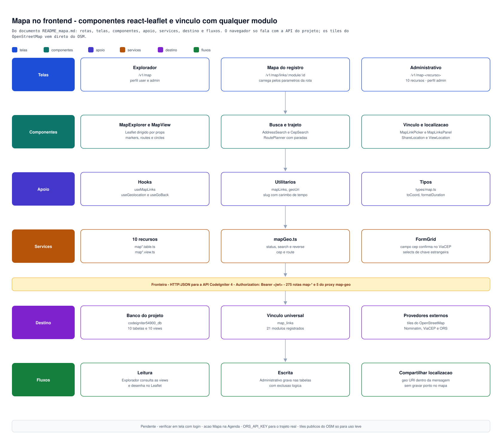

[← Base de conhecimento](../README.md)

# Mapa — componentes react-leaflet e vínculo com qualquer módulo

Estado (2026-10-12): **componentes, serviços, páginas, rotas e o administrativo completo dos 10 recursos prontos;
tipos, lint, build de teste e validação dos dados no banco sem erro; ainda não verificado em tela** (as telas ficam
atrás de login). Backend em
[`src/app/markdown/geral/README_modulo_map.md`](../../../../../app/markdown/geral/README_modulo_map.md).

Stack: Leaflet 1.9.4 + react-leaflet 5.0.0 (+ `@types/leaflet` 1.9.22), tiles do OpenStreetMap; trajetos pelo
OpenRouteService e endereços pelo Nominatim, **sempre pelo proxy do backend** (`map-geo`). O navegador só
carrega os tiles direto do OSM (uso leve, atribuição obrigatória).

## Diagrama

_Visão em quadros do mapa no frontend — telas, componentes, apoio, services, destino e fluxos. O preview reduz a imagem para a largura da janela — [abrir o SVG em tamanho real](diagramas/README_diagrama_mapa_frontend.svg)._

## Peças

| Arquivo                                  | Função                                                                                                                                                                                                                                                                |
| ---------------------------------------- | --------------------------------------------------------------------------------------------------------------------------------------------------------------------------------------------------------------------------------------------------------------------- |
| `components/map/MapView.tsx`             | Mapa Leaflet por props: `markers[]`, `routes[]` (coordenadas `[lng, lat]`), `center`, `zoom`, `fitToContent`, `tileUrl`, `onMapClick`. Marcadores são `L.divIcon` com Bootstrap Icons (os PNG padrão do Leaflet quebram no Vite). Importa `leaflet/dist/leaflet.css`. |
| `components/map/AddressSearch.tsx`       | Busca de endereço (`map-geo/search`), lista de resultados → `onSelect(GeoAddress)`                                                                                                                                                                                    |
| `components/map/CepSearch.tsx`           | CEP georreferenciado (`map-geo/cep`) → `onResolved(PostalCodeRow)`; usa o campo `cep` do FormGrid                                                                                                                                                                     |
| `components/map/RoutePlanner.tsx`        | Paradas (reordenar/remover), perfil (carro, caminhão, bicicleta, a pé), cálculo e “calcular e gravar” (`map-geo/route`), com distância e tempo total e por trecho                                                                                                     |
| `components/map/MapLinkPicker.tsx`       | Modal “Vincular ao mapa” com 4 abas: endereço, CEP, ponto (clique ou lat/lng) e rota; cria o destino e o `map_links`                                                                                                                                                  |
| `components/map/MapLinksPanel.tsx`       | **Painel de um registro de qualquer módulo**: mapa + lista dos vínculos; vincular e remover (confirmação + toast)                                                                                                                                                     |
| `components/map/MapExplorer.tsx`         | Tela de trabalho: escolhe o `map_manager`, mostra os pontos, busca endereço/CEP e planeja trajeto clicando no mapa                                                                                                                                                    |
| `hooks/useMapLinks.ts`                   | Carrega os vínculos por `module` + `referenceId` (+ `collection`) em `view_map_links` (filtros exatos `filters[...]`)                                                                                                                                                 |
| `utils/mapLinks.ts`                      | Funções puras: título, subtítulo, ícone, marcador e linha de um vínculo; `safeIcon`/`safeColor` (valores do banco entram em HTML)                                                                                                                                     |
| `types/map.ts`                           | Tipos, perfis de rota, `toCoord`, `formatDuration`, `formatDistance`                                                                                                                                                                                                  |
| `services/v1/map*.table.ts` / `.view.ts` | 10 recursos (`createResource`) + `mapGeo.ts` (5 rotas do proxy)                                                                                                                                                                                                       |
| `pages/v1/map/explorer/ExplorerPage.tsx` | Wrapper de `MapExplorer`                                                                                                                                                                                                                                              |
| `pages/v1/map/links/LinksPage.tsx`       | Wrapper de `MapLinksPanel` (lê `:module` e `:id`, valida, botão Voltar)                                                                                                                                                                                               |
| `routes/v1/map.routes.tsx`               | Rotas lazy (o Leaflet só carrega nestas telas — fica no chunk do `RoutePlanner`, fora do bundle principal)                                                                                                                                                            |

Todos os componentes são dirigidos por props e **não usam `useParams`** (regra “nada estático”); as Pages só leem
a rota. Campos de texto, CEP e select vêm do `FormGrid`.

## Rotas

| Rota                        | Página                                                                                                             |
| --------------------------- | ------------------------------------------------------------------------------------------------------------------ |
| `/v1/map`                   | `ExplorerPage`                                                                                                     |
| `/v1/map/links/:module/:id` | `LinksPage` — `module` é o slug registrado em `Config/MapLinkables.php` (ex.: `upload-manager`, `calendar-events`) |

`paths.v1.map.explorer` e `paths.v1.map.links(module, id)` em `routes/paths.ts`.

## Como um módulo usa o mapa

1. Registrar o módulo no backend (`Config/MapLinkables.php`, uma linha; hoje 21 módulos registrados).
2. Em qualquer tela do registro: `<MapLinksPanel module="calendar-events" referenceId={12} />` (ou `readOnly`).
3. Ou levar o usuário à tela pronta: `paths.v1.map.links('calendar-events', 12)`.
4. Em listas do `list_manager`: ação `link` com `href_template` `/v1/map/links/<module>/{id}`.
   **Piloto aplicado:** ação “Mapa” na lista do Upload (`list_actions` id 116).

## Administrativo (CRUD de tela dos 10 recursos)

Padrão consolidado do módulo CompanyManager e conferido com Messages, Chat e Timeline: cada recurso tem 3 páginas
finas (`GetAllPage` → `ListBuild`, `CreatePage`/`UpdatePage` → `RecordFormBuild`), lista sobre a **view**
(`list_manager`/`list_columns`/`list_actions`), formulário sobre a **tabela** (`form_manager` `criar-`/`editar-`),
exclusão lógica com confirmação, botão Voltar e item de menu. Tudo `admin` (`RequireRole`); o Explorador é `user` e
`admin`. Banco: menu, listas e formulários no `list_manager`/`form_manager` e 29 rotas React em `route_manager`
(inclui `/v1/map` e `/v1/map/links/...`).

| Recurso                 | Rota                    | Lista (slug)        | Cadastro / edição                                                                                                   |
| ----------------------- | ----------------------- | ------------------- | ------------------------------------------------------------------------------------------------------------------- |
| Mapas                   | `/v1/map-manager`       | `map-manager`       | `criar-mapa` / `editar-mapa` (perfis `roles[]` em select múltiplo)                                                  |
| Ícones                  | `/v1/map-icons`         | `map-icons`         | `criar-icone-mapa` / `editar-icone-mapa`                                                                            |
| Categorias              | `/v1/map-categories`    | `map-categories`    | `criar-categoria-mapa` / `editar-categoria-mapa`                                                                    |
| CEPs                    | `/v1/map-postal-codes`  | `map-postal-codes`  | `criar-cep-mapa` / `editar-cep-mapa`                                                                                |
| Endereços               | `/v1/map-addresses`     | `map-addresses`     | `criar-endereco-mapa` / `editar-endereco-mapa`                                                                      |
| Pontos                  | `/v1/map-points`        | `map-points`        | `criar-ponto-mapa` / `editar-ponto-mapa`                                                                            |
| Trajetos                | `/v1/map-routes`        | `map-routes`        | só `editar-trajeto-mapa`; **"Novo trajeto" abre o planejador** em `/v1/map`                                         |
| Paradas                 | `/v1/map-route-stops`   | `map-route-stops`   | `criar-parada-trajeto` / `editar-parada-trajeto`                                                                    |
| Vínculos                | `/v1/map-links`         | `map-links`         | `criar-vinculo-mapa` / `editar-vinculo-mapa` (`module`, `reference_id` e `link_type` ficam desabilitados na edição) |
| Cache de geocodificação | `/v1/map-geocode-cache` | `map-geocode-cache` | **dispensado** (só lista e exclusão; sem `CreatePage`/`UpdatePage`)                                                 |

Menu: pai **Mapa** (offcanvas) com Explorador + os 10 recursos. Totais: 10 listas, 84 colunas, 19 ações, 17
formulários, 175 campos.

**Dispensas (regra de CRUD completo, item 4):**

- `map_geocode_cache`: tabela escrita só pelo proxy `map-geo`; sem Criar/Editar, fica Ler e Excluir (limpar o cache
  força nova consulta).
- `map_routes`: o trajeto nasce no planejador (calcula distância, tempo e geometria); aqui só se ajustam nome,
  mapa, perfil, status e dono.
- Mídia: só `map_icons.upload_id` referencia um anexo, que vive no módulo Upload e tem o visualizador próprio.
- Campos de máquina (`geometry`, `bbox`, `result_json`, `query_hash`, `calculated_at`, `expires_at`, `eta`) e JSON
  livre (`extra_json`, `options_json`) ficam fora dos formulários.

**Botão Voltar:** todas as listas do Map (`ListBuild` com `backFallback`), os formulários (`RecordFormBuild`), o Explorador e o
mapa de um registro têm “Voltar” para a **última tela visitada** (`hooks/useGoBack`); se a tela foi aberta direto, vai para o
caminho de reserva (lista de Trajetos, Explorador ou lista do recurso). Salvar continua levando à lista do recurso.

**Fake fill (dev-only):** os 8 formulários de cadastro (`criar-mapa`, `criar-icone-mapa`, `criar-categoria-mapa`,
`criar-cep-mapa`, `criar-endereco-mapa`, `criar-ponto-mapa`, `criar-parada-trajeto`, `criar-vinculo-mapa`) têm o botão
“Fake fill” (canto inferior esquerdo, só em host de desenvolvimento e só no cadastro). Scripts em
`dev/fakeFill/mapa.ts`, registrados em `dev/fakeFill/registry.ts`; o botão passou a ser montado também no
`RecordFormBuild` (global). Selects de chave estrangeira usam a primeira opção da lista
(`selectFirstComboboxOption`); slug de Mapa e Categoria fica em branco para testar o slug automático.

**Slug automático:** nos cadastros de Mapa e Categoria o campo slug é **preenchido na tela** enquanto se digita o
título/nome, no formato `slug-do-texto_AAAAMMDDHHMMSS` (AAAA ano, MM mês, DD dia, HH hora, MM minuto, SS segundo;
ex.: `engenho-novo_20261011173327`). Prop `autoSlug={{ from, to }}` do `RecordFormBuild` + `stampedSlug()` em
`utils/slug.ts`; para de acompanhar se o usuário editar o slug (apagá-lo religa). O backend também garante o sufixo no
cadastro (não duplica se já veio) e, na edição, o slug é mantido.

**Atribuição como select (catálogo de tiles):** no formulário de Mapa o campo Atribuição é um select com 42 provedores de
tiles raster XYZ compatíveis com o Leaflet (OpenStreetMap em 4 variantes, OpenTopoMap, CyclOSM, CARTO ×8, Esri ×7, e os que
exigem chave: Stadia ×6, MapTiler ×4, Mapbox ×6, Thunderforest ×4, Jawg ×3 — trocar `SUA_CHAVE` na URL). Escolher a opção
preenche também a URL dos tiles (`select_config_json.fillFields`). Para isso `services/formSchema.ts` (`optionList`) passou a
preservar chaves extras das opções. Outro provedor pode ser gravado pela API
(o backend não restringe o valor), mas só aparece no select se acrescentado ao catálogo. Google Maps e Bing ficam de fora
(exigem SDK/termos próprios, não tile XYZ).

**Limites conhecidos do motor genérico:** o submit omite campo vazio, então um texto opcional não pode ser limpo pela
edição (select de chave estrangeira pode, pelo ✕); `lat`/`lng` são texto com padrão (sem seletor visual — o clique
no mapa existe no `MapLinkPicker` e no Explorador); `roles` do mapa só se altera por seleção (para esvaziar, mexer no
banco). O campo `module` do vínculo usa sugestões (datalist) copiadas de `Config/MapLinkables.php`: módulo novo no
registro deve ser acrescentado também ao campo `module` (form_fields do `criar-vinculo-mapa`).

**Validação feita (dados):** `JSON_VALID` nas colunas JSON novas (0 inválidas); 175/175 `field_name` existem como coluna
da tabela; 84/84 `field_key` de lista existem na view; ordenação padrão e views conferidas; `view_form_manager`
devolve os campos dos novos formulários. Também: `tsc`, `eslint` e build de teste sem erro (`src/public/app`
intacto). **Não verificado em tela.**

## Localização em conversas (mensagens privadas e de grupo)

Botão “Compartilhar minha localização” (ícone de pino) no envio do `ConversationPane` — o mesmo componente da conversa
privada e da de grupo. Fluxo: o navegador pede **autorização** (`navigator.geolocation`: GPS, Wi-Fi e antenas; **não** usa IP
nem roteador, imprecisos) → o modal mostra o ponto no mapa com o raio de precisão e o endereço aproximado
(`map-geo/reverse`, opcional) → o usuário confirma → a mensagem sai pelo fluxo normal com a posição no formato **geo URI**
(RFC 5870) dentro do texto: `Localização compartilhada: Praça Mauá, Centro (geo:-22.896300,-43.177900;u=15)`. No balão o
código some e aparece **“Ver no mapa”** (modal só leitura, com link para o OpenStreetMap).

Decisão (Opção B): a posição fica **dentro da mensagem**, não em `map_points`/`map_links`, para herdar a privacidade da
conversa (hoje qualquer usuário logado lê pontos e vínculos do Map pela API). Salvar como ponto do Map seria a Opção A e
exigiria antes uma regra de acesso por participante nas views do Map.

Peças: `hooks/useGeolocation.ts`, `utils/geoUri.ts` (`buildLocationMessage`, `splitGeoUri`),
`components/map/ShareLocationModal.tsx` e `ViewLocationModal.tsx` (carregados com `React.lazy`: o Leaflet só entra ao abrir um
modal), `MapView` com a nova prop `circles` (raio de precisão) e `types/map.ts` (`MapCircle`).

Cuidados: só funciona em **https ou localhost** (em produção na KingHost o site precisa estar em HTTPS); mensagem
**agendada** leva a posição de quando foi criada; em computador sem GPS a precisão pode passar de 500 m (o modal avisa);
a localização é sempre enviada na hora (sem agendar). Verificado: `tsc`, `eslint`, build de teste (Leaflet fora do chunk do
chat) e as funções do geo URI no Node. **Não verificado em tela.**

## Pendências e cuidados

- **Verificar em tela** (login necessário): `/v1/map`, `/v1/map/links/upload-manager/{id}`, as 10 listas e os
  17 formulários do administrativo (cadastrar, editar, excluir, Voltar), marcadores, clique no mapa e o modal xl
  (o `ResizeObserver` corrige o tamanho do mapa dentro do modal).
- **Agenda não recebeu a ação “Mapa”:** a tela da Agenda ignora ações `link` (`RowActionButton`); precisa de uma
  ação `modal` própria com `MapLinksPanel`.
- **Trajeto real:** depende de `ORS_API_KEY` no serviço `php` do `docker-compose.yml`; sem ela o cálculo mostra a
  mensagem 503 do servidor.
- **Tipo `map` no FormGrid:** não feito; no cadastro de um registro novo não existe `reference_id`, então o fluxo é
  salvar e depois vincular.
- O campo `cep` do FormGrid confirma o CEP direto no ViaCEP (comportamento anterior do componente); a
  coordenada vem do proxy.
- `npm audit` aponta 2 vulnerabilidades altas em `brace-expansion` (ferramentas de desenvolvimento, já existiam;
  não vêm do Leaflet).
- Tiles públicos do OSM: para muito tráfego, trocar `map_manager.tile_url` por outro provedor.

[← Base de conhecimento](../README.md)

---

[◄ Índice da base de conhecimento](../README.md)

---

### 📌 Metadados do Autor

| Campo               | Informação                                                                                                                   |
| ------------------- | ---------------------------------------------------------------------------------------------------------------------------- |
| **Nome**            | Gustavo Hammes                                                                                                               |
| **Local**           | Rio de Janeiro                                                                                                               |
| **LinkedIn**        | [linkedin.com/in/gustavo-hammes](https://www.linkedin.com/in/gustavo-hammes)                                                 |
| **Stack principal** | PHP (Laravel, Symfony, Cake, Codeigniter), Java Spring Boot, JS/TS (React, Angular, Node.js), Mobile (React Native, Flutter) |

## Localização inicial e viés da busca de endereço

- `MapExplorer` pede a posição ao navegador (`useGeolocation`) ao abrir. Com permissão e sem centro no
  `map_manager`, o mapa abre na posição do usuário (zoom 14) com o marcador "Você está aqui".
- Negada, indisponível ou sem https: abre no Estado do RJ (`FALLBACK_CENTER`, zoom 8) — `utils/mapRegion.ts`.
- A busca de endereço envia `viewbox` (`map-geo/search?viewbox=left,top,right,bottom`): caixa de ~250 km ao redor
  do usuário ou, sem GPS, o Sudeste do Brasil. O backend (`NominatimClient::search`) busca primeiro DENTRO da caixa
  (`bounded=1`) e completa com resultados de fora (`bounded=0`, sem repetir), então a região do usuário vem
  sempre primeiro. O `viewbox` entra na chave de cache (`search2|`).

## Trajeto: Ida e Volta

- `RoutePlanner` tem dois campos de endereço (`AddressSearch`): **Ida (origem)** e **Volta (destino)**. A lista de
  paradas é a fonte única: primeira = Ida, última = Volta, o meio = intermediárias. O clique no mapa continua
  adicionando paradas. A Volta só habilita depois de haver uma Ida.
- Gravar exige mapa escolhido (`mapManagerId`); sem ele aparece o aviso "Escolha um mapa para gravar o trajeto".

## Reserva de rotas (OSRM)

Se o OpenRouteService falhar (timeout, 5xx, 429, chave), `GeoController::directions` tenta o OSRM público
(`OsrmClient`, `MapProviders::$osrmUrl`) — **só para `driving-car`**; a pé, bicicleta e caminhão seguem
dependendo do ORS. Erro 422 (sem rota possível) não aciona a reserva. O trajeto gravado leva `provider = 'osrm'`
em `map_routes` (coluna já livre, sem mudança de tabela). Custo: até 8 s de espera do ORS antes da reserva.

## Escolher o centro do mapa no cadastro (`FormCenterPicker`)

`components/map/FormCenterPicker.tsx` entra no cadastro/edição de Mapa (`map-manager`) via a prop `afterFields`
do `RecordFormBuild`. Clique no mapa, busca de endereço (lupa) ou "Usar minha localização" preenchem
`center_lat`, `center_lng` e `zoom`; digitar nesses campos move o marcador. Como o FormGrid é não controlado,
o componente lê/escreve os inputs pelo nome (setter nativo + evento `input`), sem mudar o banco nem o formulário
cadastrado em `form_fields`. Props: `latName`, `lngName`, `zoomName`. `MapView` ganhou `onZoomChange`.

`FormCenterPicker` também serve ao cadastro/edição de **ponto** (`map-points`): `latName="lat" lngName="lng" label="ponto"`,
sem `zoomName` (o zoom não é gravado). O marcador só aparece com coordenada válida; busca/GPS aproximam para zoom 15.

Também usam o `FormCenterPicker` (`lat`/`lng`, sem zoom): endereços (`map-addresses`), CEPs (`map-postal-codes`) e paradas de
trajeto (`map-route-stops`), no cadastro e na edição. Não há mais formulário de mapa com latitude/longitude só em texto.

## O que do cadastro aparece no mapa (2026-10-17)

- **Ponto:** ícone do ponto, senão o da categoria (`view_map_points.mi_*`); cor = cor do ícone, senão da categoria; tamanho e âncora de `map_icons`; ícone tipo imagem/SVG vira `` via `blob:` (fetch autenticado do upload); popup com descrição, categoria e endereço.
- **Trajetos gravados** (`map_routes`, ativos do mapa): linha por `mr_geometry`, cor por perfil (`PROFILE_COLORS`), popup com nome, distância e tempo; paradas (`map_route_stops`) numeradas como marcadores.
- **Vínculos** (`view_map_links.pt_*`): marcador de ponto usa o mesmo ícone/cor/tamanho; trajeto usa a cor do perfil. Ícone imagem/SVG ainda não é desenhado no painel de vínculos.
